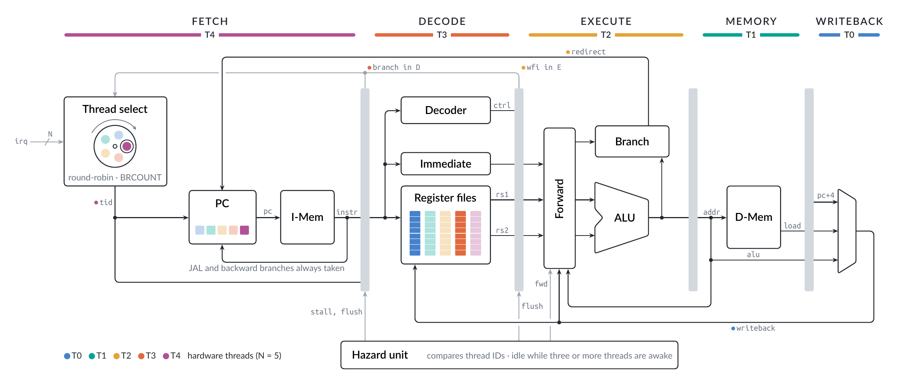

# Rx32

A fine-grained multithreaded, five-stage pipelined RISC-V (RV32I) microarchitecture implementation. It deals with hazards by filling the pipeline with instructions from N (configurable) separate programs.

Achieves a maximum throughput of 1 IPC with a minimum of 3 threads. With BRCOUNT dynamic thread scheduling, 2 threads achieve 0.97 IPC. A single thread achieves around 0.81 IPC.

Single thread performance only suffers *if* there are multiple threads in the pipeline, which is entirely optional and expected. This provides a trade-off knob for the user to choose between single-thread performance and throughput.

